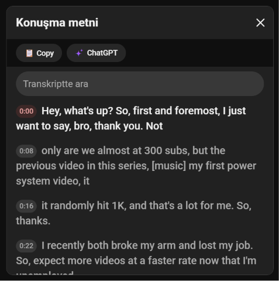

# YouTube Transcript to AI

Free Chrome extension — no API keys, no accounts, no tracking. It adds one button to YouTube's Like/Share row:

| Control | What it does |
|---|---|
| ✨ **ChatGPT** (your default AI) | One click: sends the transcript to your default AI in a new tab — temporary/incognito chat (on by default), prompt pre-filled |
| **▾** menu | Send once to Claude, ChatGPT, or Gemini (your default stays as is), or copy the transcript with / without timestamps |

Works on regular videos, live replays (`/live/…`) and Shorts (a round ✦ button above Like). No need to open YouTube's transcript panel. Click the extension icon for settings: default AI, prompt, temporary chat, include description.

> **Why isn't this on the Chrome Web Store?** Google charges a $5 developer fee. This extension is free, so: manual install. It takes 30 seconds.



## Install

1. **[⬇ Download ZIP](https://github.com/HamzaYslmn/youtube-transcript-summarizer-free/archive/refs/heads/main.zip)** and extract it
2. Open `chrome://extensions` in Chrome (copy-paste it into the address bar)
3. Turn on **Developer mode** (toggle, top right)
4. Click **Load unpacked** → select the extracted folder

Open any YouTube video that has captions — the button sits left of the Like button (icon-only on narrow windows).

## How it works

- The transcript is fetched in the background, fastest source first:
  1. the video player's own caption track (~130 ms; captions are switched on for a split second, hidden, then restored)
  2. YouTube's app API (~300 ms; also works while an ad is playing)
  3. YouTube's transcript panel, opened and closed again (last resort)
- Hovering the button already starts loading, so the click is usually instant
- Temp chat (when enabled) opens via URL param on ChatGPT (`?temporary-chat=true`) and Claude (`?incognito=`); on Gemini a helper script clicks the temp-chat button
- The prompt is too long for a URL, so the helper script types it into the editor on all three sites
- The prompt is always copied to your clipboard too — if a site's UI changed, just paste (Ctrl+V)

Project layout:

```
manifest.json
src/shared/settings.js   settings state + message format (popup and YouTube)
src/youtube/player.js    fetches the transcript (page context, 3 sources)
src/youtube/content.js   the ✦ button and menu
src/youtube/content.css
src/chat/fill.js         types the prompt into Claude / ChatGPT / Gemini
src/popup/               settings popup
```

Message format:

```
{prompt}

Title: {title}

Transcript:
{transcript}

Video Description:
{video description}
```
